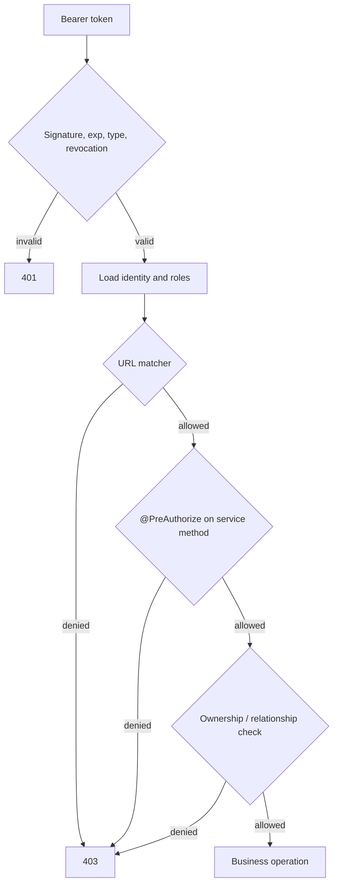
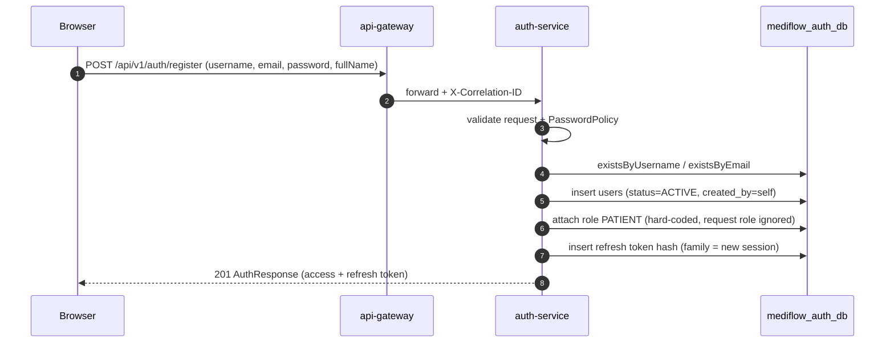
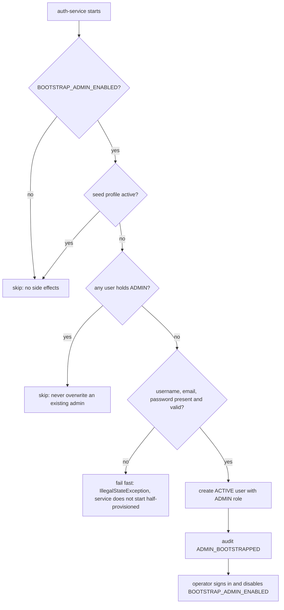
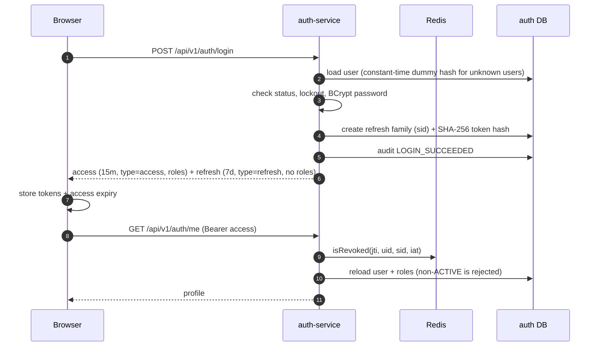
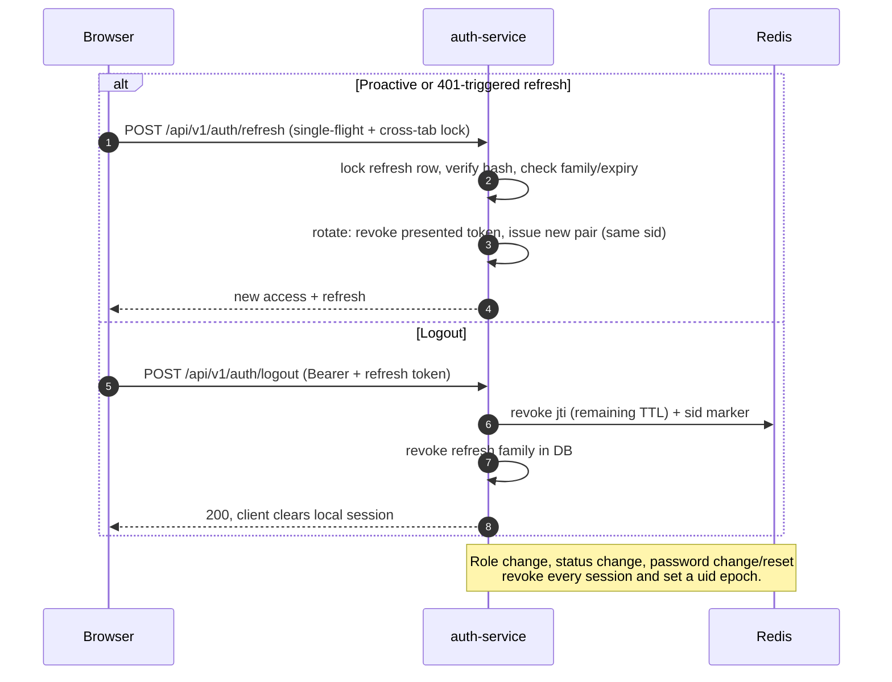

# MediFlow Security

*Status: reflects the implemented codebase (updated 2026-11-24, Milestone 9 - authorization hardening, secure onboarding and request correlation).*

## 1. Authentication model

- `auth-service` (port 8081) issues **JWT access tokens** and **JWT refresh tokens**, signed **HS256** (JJWT 0.12.6) with the shared `JWT_SECRET`. The provider refuses to start with a key shorter than 256 bits, and `JWT_SECRET` has no default.
- Both token types carry `sub` (username), `uid` (Auth `User.id`), `jti` (unique UUID per token), `sid` (refresh-token family id = login session), `iat`, `iat_ms` (millisecond precision issued-at) and `exp`. They are distinguished by `type`:
  - access tokens: `type=access`, plus `roles`;
  - refresh tokens: `type=refresh`, **no** `roles` (a refresh token can never authorize an API call; every `JwtAuthenticationFilter` rejects it).
- Default access lifetime `JWT_EXPIRATION` = 900000 ms (15 min); refresh lifetime `JWT_REFRESH_EXPIRATION` = 604800000 ms (7 days).
- Passwords are hashed with **BCrypt**. The password policy (`auth.password.*`, `PasswordPolicy`) enforces a minimum length (default 8), letters **and** digits, a 72-byte maximum (BCrypt truncates beyond that) and rejects the username inside the password.
- Refresh tokens are stored in `refresh_tokens` as a **SHA-256 hash** (`token_hash`) plus `jti`, `family_id`, `replaced_by_jti`, `expiry_date`, `revoked`, `revoked_at`, `revoke_reason`. A database dump therefore cannot be replayed against the token endpoint.
- **Rotation** (`AuthServiceImpl.rotate`): the presented token is revoked (`revoke_reason=ROTATED`, `replaced_by_jti=<new jti>`) and a new pair is issued in the same family. The row is read with a `PESSIMISTIC_WRITE` lock, so concurrent refreshes are serialised instead of minting two independent chains.
- **Reuse detection**: a revoked token presented again within `auth.refresh.reuse-grace` (default `10s`) is treated as a retry/replay of the same request (the family's current active token is rotated for the caller). Outside that window it is treated as theft: the whole family is revoked in the database *and* in the shared registry, an audit event is written and the request fails. The revocation is committed even though the request fails (`@Transactional(noRollbackFor = AuthenticationFailedException.class)`), otherwise the detection would roll itself back.
- **Logout** revokes the caller's session (refresh-token family in the DB + `sid` marker in Redis) and blacklists the exact access token (`jti`) for its remaining lifetime. Other sessions of the same user stay alive.
- Public endpoints: `/api/v1/auth/register`, `/login`, `/refresh`, `/password-reset/request`, `/password-reset/confirm`; everything else (`/me`, `/logout`, `/change-password`, `/api/v1/auth/users/**`) requires a valid token (user administration additionally requires `ADMIN`).
- The auth-service filter loads the user row and rejects any non-`ACTIVE` account on **every** request, so a suspended/deactivated user cannot keep using an already-issued access token even before Redis sees the revocation.

## 2. Access-token revocation (selected architecture)

Every service validates JWTs **locally** (no per-request call to auth-service). Revocation therefore has to be visible to all services.

**Decision: Redis-backed shared revocation registry, read by every service.** Rejected alternatives:

| Option | Why not chosen |
|---|---|
| Revocation only in auth-service | Would not protect the other services, which never call auth-service to validate a token. Explicitly unsafe. |
| Gateway token introspection for all `/api/v1/**` | Centralises validation but requires the gateway to become a security choke point and forces every service to trust gateway-injected identity headers: a much larger change to the trust model, and it does not protect services called directly or from Kafka-driven flows. |
| Very short access tokens only | Reduces but does not remove the window; still cannot express logout/suspension immediately. |

Implementation (`common-library`, package `com.mediflow.common.security`):

- `TokenRevocationRegistry` - single contract: `isRevoked(jti, uid, sid, iat)`, `revokeToken`, `revokeSession`, `revokeAllForUser`.
- `RedisTokenRevocationRegistry` - the runtime implementation (`StringRedisTemplate`). Keys:
  - `{prefix}jti:<jti>` = `1`, TTL = remaining token lifetime (single-token revocation);
  - `{prefix}sid:<sid>` = revocation epoch millis, TTL `marker-ttl` (one login session);
  - `{prefix}uid:<uid>` = revocation epoch millis, TTL `marker-ttl` (all sessions of a user).
  A token is revoked when its `jti` is blacklisted or when it was issued **strictly before** a session/user revocation epoch. Tokens minted after the epoch (a fresh login after a password change) remain valid, so revocation never permanently locks an account.
- `NoOpTokenRevocationRegistry` - installed only when `security.revocation.enabled=false` (test/local escape hatch; insecure).
- `TokenRevocationGuard` - adapter used by every `JwtAuthenticationFilter` right after signature validation; reads `iat_ms` (falling back to `iat`) for precise epoch comparison.
- **Fail-closed by default**: if Redis is unreachable, `security.revocation.fail-open=false` makes the filter return **503** (`SecurityResponses.serviceUnavailable`) instead of accepting a possibly revoked token. `fail-open=true` is documented as unsafe.
- **Refresh tokens are rejected as bearer credentials** in every service.

Revocation triggers:

| Event | Refresh tokens | Access tokens |
|---|---|---|
| Logout | current family revoked | presented token blacklisted, current `sid` revoked |
| Refresh rotation | presented token revoked | old access tokens stay valid until `exp` (short-lived by design) |
| Refresh-token reuse (outside grace) | whole family revoked | whole `sid` revoked |
| Password change / reset | all user tokens revoked | `uid` epoch set - all tokens issued before it are rejected |
| Role change (admin API) | all user tokens revoked | `uid` epoch set (roles are embedded in the token, so a re-login is required) |
| Status change to `SUSPENDED`/`INACTIVE`/`PENDING_VERIFICATION` | all user tokens revoked | `uid` epoch set (+ auth-service rejects non-`ACTIVE` at every request) |

## 3. Account lifecycle

- Statuses (`AccountStatus`): `ACTIVE`, `INACTIVE`, `SUSPENDED`, `PENDING_VERIFICATION`, `LOCKED`, `DELETED`. Administrators may only set `ACTIVE`, `INACTIVE`, `SUSPENDED` and `PENDING_VERIFICATION`; `LOCKED` (temporary login throttling) and `DELETED` are rejected by the admin API.
- Admin API (`ADMIN` only): `GET /api/v1/auth/users`, `GET /api/v1/auth/users/{id}`, `PATCH /api/v1/auth/users/{id}/status`, `PATCH /api/v1/auth/users/{id}/roles`. Every change is audited and revokes all sessions of the target. Administrators cannot suspend/deactivate themselves or remove their own `ADMIN` role.
- Role assignment accepts only the `UserRole` names (`PATIENT`, `DOCTOR`, `NURSE`, `ADMIN`, `BILLING_STAFF`, `SUPPORT`). Unknown names are rejected; a whitelisted name missing from the catalogue is created on demand (the migration also seeds the full catalogue - see V3).
- Role changes take effect on the next login: the auth-service filter reads roles from the database per request, while resource services read them from the token, which is why existing tokens are revoked.
- Password change (`POST /api/v1/auth/change-password`) requires the current password, enforces the policy, clears lockout counters, updates `password_changed_at` and revokes **all** sessions of that user.
- Password reset (`POST /api/v1/auth/password-reset/request` + `/confirm`): the request endpoint answers identically for unknown addresses (no account enumeration). Tokens are stored as SHA-256 hashes in `password_reset_tokens`, single-use, expire after `auth.password-reset.token-ttl` (default 30 min), and confirming revokes all sessions. Because the project has no mail infrastructure, `auth.password-reset.expose-token=true` returns the raw token in the response **for local/dev/test only** (default `false`).
- Authentication failures never reveal whether the account exists: wrong password and unknown user return the same `401 Invalid username or password`, and an unknown username still pays one BCrypt verification against a dummy hash so response timing cannot be used for enumeration. Status-specific messages (403) are returned **only after** the password was verified, which prevents status enumeration.

## 4. Login protection

- Failed logins are counted in `users.failed_login_attempts` (`LoginAttemptService`, `REQUIRES_NEW` transactions with a row lock so concurrent guessing cannot race the threshold). On success the counters are cleared.
- At `SECURITY_LOGIN_MAX_FAILED_ATTEMPTS` (default 5) the account is locked until `now + SECURITY_LOGIN_LOCKOUT_DURATION` (default 15 min) and the counter is reset, so the next window starts clean. A locked account returns **429** with a `Retry-After` header.
- The lockout is **always time-based** - there is no permanent lock state - so an attacker cannot permanently deny access to a known account (lockout DoS). The lock is checked before password verification to avoid paying BCrypt cost on flooded attempts.
- Audit events (`auth_audit_events`, isolated `REQUIRES_NEW` writes so they survive a rolled-back login): `REGISTERED`, `LOGIN_SUCCEEDED`, `LOGIN_FAILED`, `LOGIN_BLOCKED`, `LOGIN_LOCKED_OUT`, `TOKEN_REFRESHED`, `REFRESH_REJECTED`, `REFRESH_REUSE_DETECTED`, `LOGOUT`, `PASSWORD_CHANGED`, `PASSWORD_RESET_REQUESTED`, `PASSWORD_RESET_COMPLETED`, `ACCOUNT_STATUS_CHANGED`, `ACCOUNT_ROLES_CHANGED`. Each row stores user id/username, outcome, IP, user agent and a truncated detail.
- This is per-account throttling. Per-IP/global rate limiting is **not** implemented (see §12).

## 5. Frontend session handling

- `src/api/client.ts` stores `accessToken`, `refreshToken` and the access expiry timestamp. It refreshes **proactively** (`exp - 30s`) before a request and **reactively** on `401`, then retries the request once.
- Refreshes are single-flight per tab (one shared promise) and guarded by a `localStorage` lock across tabs, so two tabs never rotate the same refresh token concurrently; the losing tab adopts the tokens written by the winner.
- When a refresh fails the client clears the session and emits `mediflow:session-ended`; `AuthContext` sets a visible notice ("Your session has expired. Please sign in again.") so the user is not silently dropped.
- Session restoration after a reload works with either token present: the client refreshes when the access token is missing/expired and retries `/api/v1/auth/me`.
- Pages: `/login`, `/forgot-password`, `/reset-password?token=...` (public) and `/account/password` (authenticated). A successful password change/reset clears local state and shows a confirmation on the login page. `403` (inactive/suspended) and `429` (lockout) responses are surfaced explicitly.

## 6. Role model

`common-library` `UserRole` enum: `PATIENT`, `DOCTOR`, `NURSE`, `ADMIN`, `BILLING_STAFF`, `SUPPORT`. Migrations seed the full catalogue (V1: `PATIENT`/`DOCTOR`/`ADMIN`; V3: `NURSE`/`BILLING_STAFF`/`SUPPORT`). Registration always assigns `PATIENT` - the client-supplied `role` field is ignored (previously, supplying `role=ADMIN`/`DOCTOR` on registration escalated the new account to a privileged role; fixed 2026-08-18). Privileged roles are granted only through the admin API, the one-time bootstrap, the seeders or an operator directly in the DB.

**Why `SUPPORT` exists.** It is a read-only operational role for help-desk/front-office staff: it can
look up appointments, invoices, patient and doctor directories and its own notifications so it can
answer "where is my invoice / when is my visit?" questions, but it cannot mutate business state and
cannot read clinical records. It is not a stepping stone to another role; if an organisation does not
run a help desk, the role can simply go unused. It exists because removing it would force those users
onto `BILLING_STAFF` or `ADMIN`, which carry write access they must not have.

The dev-only `seed` profile creates one deterministic account per role (`admin`, `doctor`, `patient`, `nurse`, `billing`, `support`; see `DevSeedData`) so every authorization path can be exercised end to end. It is idempotent and must never run against production data.

### Authoritative role-permission matrix

| Capability | ADMIN | DOCTOR | PATIENT | NURSE | BILLING_STAFF | SUPPORT |
|---|---|---|---|---|---|---|
| Patient profile create | yes | yes | own only | no | no | no |
| Patient profile read (list/get) | all | all | own only | all | all | all |
| Patient profile update | yes | yes | no | no | no | no |
| Patient profile delete (soft) | yes | no | no | no | no | no |
| Doctor profile create/update | yes | own only | no | no | no | no |
| Doctor profile read / search | all | own profile only (search open) | all (search) | all | all | all |
| Doctor availability/leave write | yes | own only | no | no | no | no |
| Appointment read / history | all | own only | own only | all | all | all |
| Appointment create/reschedule/cancel/confirm | all | own only | own only | all | **no** | **no** |
| Appointment start/complete/no-show | all | own only | no | yes | no | no |
| Medical record read | all | own records | own records | **no** | **no** | **no** |
| Medical record audit history read | all | own records | own records | **no** | **no** | **no** |
| Medical record create/update | all | own records | no | no | no | no |
| Medical record reassign `patientId` | yes | no (403) | no | no | no | no |
| Invoice/payment read | all | all | own only | all | all | all |
| Invoice/payment write | yes | no | no | no | yes | no |
| Notification read/mark-read | all | own (`recipient_id == uid`) | own | own | own | own |
| Analytics | all | all | no | no | no | no |
| Account administration (`/api/v1/auth/users/**`) | yes | no | no | no | no | no |
| Identity lookup (`/internal/identities/{id}`) | yes | yes | no | no | no | no |

Any authenticated principal whose role is not in the relevant allow-list is denied (403), including obsolete/unknown role strings. Authentication (401) always precedes authorization (403). The matrix is enforced by each service; the frontend mirrors it for UX only.

### Two enforcement layers

Since M9 every sensitive service operation carries a **method-level** rule (`@EnableMethodSecurity` +
`@PreAuthorize` on the service method) in addition to the URL matcher in `SecurityConfig` and the
ownership checks in `AccessControlService`:

| Layer | Answers | Example |
|---|---|---|
| URL matcher | "may this role call this endpoint shape at all?" | `POST /api/v1/invoices` → ADMIN/BILLING_STAFF |
| `@PreAuthorize` on the service method | "may this role perform this operation?" | `InvoiceService.createInvoice` → ADMIN/BILLING_STAFF |
| `AccessControlService` ownership | "may this caller touch *this* row?" | patient/doctor scoped to own `patientId`/`doctorId` |

The layers are deliberately redundant: a future matcher mistake cannot silently widen a write path,
and a role annotation never replaces an ownership check (role ≠ relationship).



## 7. Endpoint authorization (per service)

| Service | Rules (from `SecurityConfig`) |
|---|---|
| auth | `/register`, `/login`, `/refresh`, `/password-reset/**` public; `/api/v1/auth/users/**` → ADMIN; `/internal/**` → ADMIN, DOCTOR; everything else authenticated |
| patient | DELETE `/api/v1/patients/**` → ADMIN; POST → ADMIN, PATIENT, DOCTOR; PUT → ADMIN, DOCTOR; GET → authenticated (PATIENT list/search scoped to own profile) |
| doctor | POST/PUT/DELETE `/api/v1/doctors/**` (including availability/leave writes) → ADMIN, DOCTOR (DOCTOR own profile only); GET → authenticated |
| medical-record | POST `/api/v1/medical-records` and PUT `/api/v1/medical-records/*` → ADMIN, DOCTOR (DOCTOR own records only); GET → authenticated but service-level ownership denies NURSE/BILLING_STAFF/SUPPORT (403) |
| billing | invoice/payment writes → ADMIN, BILLING_STAFF; reads → explicit set ADMIN, BILLING_STAFF, DOCTOR, NURSE, SUPPORT (PATIENT scoped to own invoices; unknown roles → 403) |
| appointment | all → authenticated; PATIENT/DOCTOR scoped to own identity, staff (ADMIN/NURSE/BILLING_STAFF/SUPPORT) broad reads, BILLING_STAFF and SUPPORT read-only, unknown roles → 403 |
| notification | all → authenticated; reads scoped to `recipient_id == uid`, mark-read owner-only (ADMIN bypass) |
| analytics | all `/api/v1/analytics/**` → ADMIN, DOCTOR (all other roles, including PATIENT/NURSE/BILLING_STAFF/SUPPORT → 403) |

Method-level rules (M9) duplicate the write matchers in the service layer:
`InvoiceService`/`PaymentCommandService` (`ADMIN`,`BILLING_STAFF`), `MedicalRecordService`
(`ADMIN`,`DOCTOR`), `PatientService` create (`ADMIN`,`PATIENT`,`DOCTOR`)/update (`ADMIN`,`DOCTOR`)/delete
(`ADMIN`), `DoctorService` + `DoctorScheduleService` (`ADMIN`,`DOCTOR`), `AppointmentService` mutations
(`ADMIN`,`DOCTOR`,`NURSE`,`PATIENT`), `AccountLifecycleService` (`ADMIN`) and
`AuthServiceImpl.getIdentity` (`ADMIN`,`DOCTOR`).


> **Dead `STAFF` grants removed (2026-11-12):** patient-service (`POST`/`PUT`) and doctor-service (`POST`/`PUT` plus the redundant schedule matcher) previously referenced `STAFF`, which is not in the `UserRole` enum and is never issued. The literals were removed rather than replaced with broader grants: `NURSE`, `BILLING_STAFF` and `SUPPORT` do **not** gain patient/doctor profile-write access. Appointment and billing `AccessControlService` sets likewise dropped the dead `"STAFF"` entry. Any token carrying `ROLE_STAFF` (or any other unknown role) is treated as unauthorized (403).

## 8. Resource ownership enforcement

The JWT `uid` (Auth `User.id`) is compared to stored business ids.

- **Patients:** `Patient.patientId == uid`. A PATIENT can only access/list their own profile; authenticated staff/doctor/admin may read profiles, while updates are restricted to ADMIN/DOCTOR by the endpoint matcher. Patient creation by a PATIENT is forced to their own uid; deleting a profile is ADMIN-only.
- **Doctors:** `Doctor.doctorId == uid`. A DOCTOR can only access/update their own profile and schedule; discovery/search is unaffected (any authenticated caller can search). Creation by a DOCTOR is forced to their own uid.
- **Medical records:** `MedicalRecord.doctorId == uid` for doctors; PATIENT read access requires `MedicalRecord.patientId == uid`; admin bypass. Search is scoped (`scopedPatientId`/`scopedDoctorId`) so a doctor only sees their own records and a patient only their own. NURSE/BILLING_STAFF/SUPPORT and unknown roles are denied. Non-ADMIN updates may not change `patientId` (403): only an administrator can correct a record assigned to the wrong patient.
- **Appointments:** enforced at the service layer by `AccessControlService`. A PATIENT is scoped to their own `patientId` and a DOCTOR to their own `doctorId` on create, list, get, history, reschedule, and cancel (a forced foreign identity returns 403); staff (ADMIN/NURSE/BILLING_STAFF/SUPPORT) have broad read access. Mutation roles (`canMutate`) are ADMIN/DOCTOR/NURSE/PATIENT: BILLING_STAFF owns billing writes only and SUPPORT is operational read-only, so both can read an appointment and its history but every create/reschedule/confirm/cancel returns 403. Start/complete/no-show additionally require a clinical role (`ADMIN`, `DOCTOR`, `NURSE`). History uses the same access rules as the appointment itself.
- **Medical-record audit history:** `GET /api/v1/medical-records/{recordId}/history` reuses the record read rules, so a patient sees only their own record history, a doctor only records they authored, and NURSE/BILLING_STAFF/SUPPORT receive 403.
- **Invoices:** read access enforced at the service layer by `AccessControlService`. A PATIENT can only list/view/inspect payments on their own invoices (a forced foreign `patientId` on the list returns 403). Organisation-wide reads are limited to the explicit set ADMIN/BILLING_STAFF/DOCTOR/NURSE/SUPPORT; any other authenticated role is denied in both `canRead` and `scopedPatientId` rather than falling through. Invoice/payment writes remain ADMIN/BILLING_STAFF only (other roles receive 403 at the endpoint matcher).
- **Notifications:** list/unread-count are scoped to `recipient_id == uid`; marking a notification read is owner-only (ADMIN bypass) and a foreign id returns 403/404 without leaking existence.

## 9. Profile identity validation (patient / doctor creation)

Admin/staff creation of Patient and Doctor profiles requires an explicit `userId` (Auth `User.id`); the profile services do **not** trust that value blindly.

1. patient-service / doctor-service forward the caller's bearer token to auth-service's internal lookup `GET /internal/identities/{userId}` (outside `/api/v1`, `@Hidden` in OpenAPI, **no gateway route**).
2. auth-service authorizes the lookup itself (`/internal/**` → `ADMIN`, `DOCTOR` only since M9). A `PATIENT`, `NURSE`, `BILLING_STAFF` or `SUPPORT` token receives 403, so the profile services cannot be used as an identity oracle and operational roles cannot enumerate identities.
3. The response contains only `userId`, `username`, `status`, `roles` - never password hashes or contact data.
4. patient-service requires the identity to hold `PATIENT`; doctor-service requires `DOCTOR`; both require `status == ACTIVE`.
5. Self-service creation skips the remote call: a PATIENT/DOCTOR creating their own profile is proven by the signed `uid` + role claims, and forcing a different `userId` returns 403.

Error mapping (fail closed): unknown identity or wrong role → 400; non-`ACTIVE` (`INACTIVE`/`SUSPENDED`/`LOCKED`/...) → 409; auth-service rejects the lookup (401/403) → 403; auth-service unreachable/5xx/empty response → 503. No profile is persisted on any of these paths.

Duplicate handling: `patients.patient_id` and `doctors.doctor_id` are `UNIQUE` and creation pre-checks the business id; a concurrent duplicate surfaces as a DB constraint violation mapped to 409, so one identity can never own two active profiles.

Configuration: `services.auth-service-url` (`AUTH_SERVICE_URL`, default `http://localhost:8081`); connect timeout 1s (`AUTH_SERVICE_CONNECT_TIMEOUT_MS`), read timeout 3s (`AUTH_SERVICE_READ_TIMEOUT_MS`); no automatic retries. A small circuit breaker (5 consecutive transport/5xx failures → open for 30s) fails fast with 503 instead of hammering a degraded auth-service; a well-formed 404/401/403 proves the dependency healthy and does **not** count as a failure. The caller's `X-Correlation-ID` is forwarded. The dependency direction is patient → auth and doctor → auth only (no cycle). Seeded ids (`DevSeedData`) match the auth seed users, so existing seed workflows are unchanged.

**Remaining limitation:** validation happens at creation time. A later role change or deactivation in auth-service does not retroactively invalidate an existing profile, and there is no distributed transaction or cache between the services. Network-level restriction of `/internal/**` (mTLS/network policy) remains an infrastructure concern.

## 10. Other controls

- **CORS:** the API gateway is the single CORS owner for browser traffic (default origin `http://localhost:3000`, env `CORS_ALLOWED_ORIGINS`, `Allow-Credentials: true`); it deduplicates CORS headers emitted by downstream services through a global `DedupeResponseHeader` filter so proxied responses carry exactly one `Access-Control-Allow-Origin`. Services keep their own CORS config for direct development access. CSRF disabled; stateless sessions.
- **Input validation:** Bean Validation (`jakarta.validation`) on request DTOs; handled centrally (see `GlobalExceptionHandler`). Malformed JSON → 400, unsupported media type → 415, invalid path/query values → 400, optimistic-lock/integrity conflicts → 409, database/revocation/downstream outages → 503.
- **Error contract:** `401` for authentication failures (generic), `403` for authorization/inactive accounts, `400`/`405`/`409`/`415` for client mistakes, `429` + `Retry-After` for lockout, `503` when the revocation store or a required dependency is unavailable and the service fails closed. Bodies never contain stack traces, SQL, credentials or PHI.
- **Actuator exposure:** only `/actuator/health/**` and `/actuator/info` are public. `/actuator/prometheus` (and every other endpoint) requires authentication, and `management.endpoint.health.show-details` defaults to `never`, so health probes cannot be used to enumerate internals.
- **Correlation:** `X-Correlation-ID` is validated (8–64 safe characters) or regenerated at the gateway, propagated via MDC and response headers, and carried on domain events. Logs are therefore traceable without logging request bodies or PHI.
- **Authentication metrics:** failed authentications are counted as `mediflow.security.authentication.failures{reason=...}` for alerting, without recording usernames.
- **SQL:** parameterized via Spring Data JPA; schema from Flyway migrations, `ddl-auto: validate`.
- **Audit:** `auth_audit_events` (who/what/when/IP/user-agent/outcome, no secrets or passwords).

## 11. Verification

- `auth-service`: `JwtProviderTest` (typed tokens, unique `jti`, `exp`, signature/expiry/malformed rejection, `describeAccessToken`), `AuthServiceImplTest`, `AuthControllerIntegrationTest` (login/logout, rotation, reuse, lockout, password change/reset, suspension, role change, forged/expired/malformed tokens), `InternalIdentityControllerIntegrationTest`, `AuthDevDataSeederTest`.
- `AuthRevocationRedisIntegrationTest` uses a real Redis (Testcontainers): logout, reuse-driven family revocation, password change and suspension all make already-issued access tokens fail.
- `RefreshConcurrencyIntegrationTest` fires two concurrent refreshes and asserts the row lock prevents two independent chains.
- patient-service `CrossServiceTokenRevocationIntegrationTest` (real Redis) proves a revocation written by auth-service's contract is enforced by an independent service that validates JWTs locally: `jti`, `sid` and `uid` revocation, refresh tokens as bearer, invalid signature/malformed/missing tokens, and tokens issued after the revocation epoch.
- Every other service keeps its RBAC integration tests (tokens minted with the service test secret) with `security.revocation.enabled=false`; revocation behaviour itself is not mocked away in the tests above.
- **M9 authorization/onboarding tests:** `AccessControlServiceTest` (appointment) covers the mutation-role set and asserts BILLING_STAFF and SUPPORT can read but not mutate; `AppointmentControllerIntegrationTest.supportCannotMutateAppointments` and `billingStaffCannotMutateAppointments` prove 403 on create/reschedule/confirm/cancel with the read path still 200; billing `InvoiceControllerIntegrationTest.rolesOtherThanAdminAndBillingStaffCannotWriteInvoices` covers the wrong-role write paths and `InvoiceControllerSecurityTest.methodSecurityDeniesInvoiceCreationForANonBillingRole` calls the proxy directly to prove the annotation (not the URL matcher) denies it; the same direct-proxy check exists for patient/doctor profile creation and medical-record writes; `InternalIdentityControllerIntegrationTest` asserts 403 for PATIENT/NURSE/BILLING_STAFF/SUPPORT and 401 for a suspended caller; `AdminBootstrapRunnerTest` covers disabled, never-overwrites, weak-password, incomplete-config, duplicate-username and concurrent-win behaviour.

## 12. Remaining limitations

- Per-IP/global rate limiting, bot detection and CAPTCHA are not implemented (only per-account temporary lockout).
- Auth-service is still the only writer of revocation state; the design supports any service writing to the shared registry.
- `try` with `fail-open=true` is documented but unsafe; production must keep fail-closed and run Redis highly available.
- HTTPS enforcement, TLS termination, secret management integration and service-to-service mutual auth remain deployment-level concerns. M8 documents nginx TLS termination and external `.env.prod` secrets but does not add mTLS.
- Redis is a mandatory runtime dependency for token validation (fail-closed => 503 when down). M8 adds AOF (`everysec`) on a named volume for restart durability; losing the volume still drops markers, so already-issued tokens remain valid until expiry (15 minutes by default). Rotate `JWT_SECRET` after such a loss.

## 13. Internal schedule credential (M7)

`appointment-service` validates every booking/reschedule against doctor-service's
`/internal/doctors/{doctorId}/schedule/validation`, which is not gateway-routed. The caller no longer
forwards a user token: appointment-service mints a **30-second service JWT** with
`iss=appointment-service`, `aud=doctor-service`, `type=service`, `scope=doctor-schedule:validate` and
a `jti`. The signing key is derived from `JWT_SECRET` with the context
`mediflow.internal-service-token.v1` (HMAC-SHA256), so no additional secret exists and a user token
can never be replayed as a service credential. doctor-service accepts only the exact issuer, audience
and scope:

| Presented credential | Result |
|---|---|
| Valid service credential | allowed |
| User access token (any role) | 403 |
| Missing, malformed, expired, wrong issuer/audience | 401 |
| A token signed with the raw `JWT_SECRET` but no service claims | 403 |

`InternalDoctorScheduleSecurityTest` (9 tests) and the E2E `internal` journey cover both directions.
Every service's `SecurityConfig` also permits the `ERROR` dispatcher so a filter-chain denial keeps
its 403 instead of degrading to a 401 (`ErrorDispatchSecurityTest`).

## 14. Demo mode and production isolation (M8)

- **Demo mode is local-only.** It is a build-time flag (`.env.demo`, `vite --mode demo`). A production
  build with `VITE_DEMO_MODE=true` is refused by `vite.config.ts`; the installer is dynamically
  imported and the banner is lazy-loaded, so a normal `dist` contains no demo code or strings.
- **No auth bypass.** The banner signs in through `AuthContext.login` with synthetic accounts; route
  guards, role checks and the API client are unchanged. The synthetic API only exists in demo builds.
- **Synthetic data only.** The demo's records are generated in memory; nothing persists server-side
  and nothing is read from a real database.
- **Production surface.** `docker-compose.prod.yml` publishes only the nginx edge (80/443). PostgreSQL,
  Redis, Kafka and all nine services are private (`expose` only). nginx proxies only the SPA and
  `/api/`; `/actuator`, `/v3/api-docs`, `/swagger-ui` and `/internal/**` return 404 at the edge.
- **Production configuration.** The overlay pins `SPRING_PROFILES_ACTIVE: ""` (no `dev`/`seed`),
  `HEALTH_SHOW_DETAILS=never`, `JPA_SHOW_SQL=false`, `SECURITY_REVOCATION_FAIL_OPEN=false` and
  `AUTH_PASSWORD_RESET_EXPOSE_TOKEN=false`. Secrets come from `.env.prod` (git-ignored, `chmod 600`);
  Compose aborts if `POSTGRES_USER`, `POSTGRES_PASSWORD` or `JWT_SECRET` is missing.
- **Verification.** 31 release-readiness checks assert the demo/production isolation and the overlay's
  port/secret/profile posture; CI validates the merged production Compose configuration.

## 15. CI supply chain (M8)

- **Least privilege.** `.github/workflows/ci.yml` sets `permissions: contents: read` for the whole
  workflow; no job writes to the repository, packages, issues or PRs, so `GITHUB_TOKEN` is read-only.
- **No repository secrets in CI.** The workflows use only `GITHUB_TOKEN` (implicit) and throwaway
  placeholders (`ci-only-placeholder`) for Compose validation. Runtime secrets are generated inside the
  E2E/smoke scripts, never stored.
- **Pinned action majors.** `actions/checkout@v7`, `actions/setup-java@v6`, `actions/setup-node@v7`,
  `actions/upload-artifact@v7` — the current stable majors verified against the GitHub API. Upgrades are
  proposed by Dependabot (`.github/dependabot.yml`) as reviewed PRs, not auto-merged.
- **Runtimes.** JDK 21 (Temurin) with Maven caching; Node 24 LTS (root `.nvmrc`) with npm caching.
  `mvn -B -ntp -U clean verify` runs the full lifecycle, so tests cannot be skipped by a stale cache.
- **Artifacts on failure only.** Playwright reports, cross-service E2E logs and release-smoke logs are
  uploaded with `if-no-files-found: ignore`, retained 7 days, and contain no secrets (scripts redact
  generated values).
- **Secret scanning.** A Gitleaks full-history scan (`--log-opts="--all"`) over all 21 commits reports no
  leaks; the only matches in the working tree are local, git-ignored files (`.env`, `target/surefire-reports`, `logs/`).

## 16. Identity lifecycle, onboarding and request correlation (M9)

### 16.1 Public registration (PATIENT only)



There is no self-service privileged registration. The request DTO no longer accepts a role, and the
service assigns `PATIENT` unconditionally, so a crafted body cannot escalate.

### 16.2 Administrator provisioning (one-time bootstrap)



- Disabled by default (`auth.bootstrap.enabled` / `BOOTSTRAP_ADMIN_ENABLED=false`).
- Runs only when **no** account holds `ADMIN`; it never promotes, resets or overwrites an existing user.
- Password is validated with the same `PasswordPolicy` as every other account and is never logged.
- Excluded from the `seed` profile so development seed accounts can never mix with production bootstrap.
- The `ADMIN_BOOTSTRAPPED` audit event records the provisioning without the credential.

### 16.3 Doctor / nurse / billing-staff onboarding

```mermaid
sequenceDiagram
    autonumber
    participant Op as Operator (ADMIN)
    participant U as New staff user
    participant A as auth-service
    participant D as doctor-service
    participant P as patient-service

    U->>A: POST /api/v1/auth/register (creates PATIENT account)
    Op->>A: PATCH /api/v1/auth/users/{id}/roles (adds DOCTOR / NURSE / BILLING_STAFF)
    A->>A: revoke all sessions of the target + audit ACCOUNT_ROLES_CHANGED
    U->>A: POST /api/v1/auth/login (new token carries the new role)
    alt Doctor self-service
        U->>D: POST /api/v1/doctors (userId forced to own uid)
    else Admin creates the profile
        Op->>D: POST /api/v1/doctors with userId
        D->>A: GET /internal/identities/{userId} (ADMIN/DOCTOR only)
        A-->>D: id, username, status, roles
    end
    D-->>Op: 201 doctor profile
    Note over Op,P: Nurse and billing staff need no profile row;<br/>they operate on clinical workflows and invoices.
```

Activation is the account status: only `ACTIVE` accounts can authenticate, and a status change
revokes every session. Deactivation therefore takes effect on the next request, not only at token
expiry.

### 16.4 Login and JWT issuance



### 16.5 Refresh, logout and revocation



The browser client keeps **one correlation id per logical request**, including the refresh that
precedes a request and the retry after a `401`.

### 16.6 Correlation-ID lifecycle

```mermaid
flowchart LR
    B[Browser api()] -->|"generate UUID v4<br/>or caller-supplied id"| G{api-gateway}
    G -->|"valid 8-64 [A-Za-z0-9._-]? keep : regenerate"| S1[downstream service]
    G -->|"echo X-Correlation-ID"| B
    S1 -->|MDC log context| L[service logs]
    S1 -->|synchronous call| S2[internal dependency]
    S1 -->|"event envelope correlationId"| K[Kafka topic]
    K --> C[notification / analytics consumer]
    S1 -->|"5xx response"| B2["ApiError.correlationId<br/>message + (reference: id)"]
```

- Correlation ids are **observability metadata, never credentials**; a forged id grants nothing.
- The response header wins over the sent value, so a gateway-regenerated id is the one the user quotes.
- Only `5xx` responses append `(reference: …)` to the message; `4xx` validation/authorization text stays clean.

### 16.7 JWT review - findings and residual risk

| Area | Current state | Verdict |
|---|---|---|
| Signing / verification | HS256, shared `JWT_SECRET`, provider rejects keys < 256 bits, no default | Sound for a single trust domain |
| Algorithm enforcement | JJWT `verifyWith` pins the key; no `alg=none`/RS→HS confusion path | OK |
| Issuer / audience | Not asserted on user tokens; service tokens assert exact `iss`/`aud` | Acceptable now; add `iss`/`aud` when a second issuer appears |
| Expiry | Access 15 min, refresh 7 days, both validated | OK |
| Token type | `type=access`/`type=refresh`; refresh rejected as bearer everywhere | OK |
| Refresh rotation / reuse | Pessimistic row lock, SHA-256 hashes, family revocation, 10 s reuse grace | OK |
| Revocation | Redis `jti`/`sid`/`uid` markers, fail-closed, auth-service also checks account status | OK (see persistence gap) |
| Role-change invalidation | All sessions revoked + `uid` epoch; resource services re-read roles only from the token | OK because revocation precedes reuse |
| Service credential | Derived 30 s HMAC service JWT, exact issuer/audience/scope, separate derived key | OK |
| Secret distribution | One shared secret in `.env`/`.env.prod`; no KMS/vault | Accepted single-VM limitation |
| Shared-HS256 risk | Any service holding `JWT_SECRET` can mint tokens for every other service | **Main residual risk** |

**Recommendation (not implemented):** migrate to asymmetric signing (RS256/ES256, or EdDSA) with
auth-service as the only holder of the private key and every other service configured with the public
key/JWKS. Because access tokens are short-lived, a controlled migration is possible without a flag day:

1. Publish a `kid` and JWKS endpoint from auth-service; keep HS256 verification enabled temporarily.
2. Switch issuance to RS256 with a `kid`, leaving the HS256 key accepted for verification only.
3. Deploy consumers with public-key verification, then remove HS256 acceptance after the refresh
   lifetime (7 days) plus skew.
4. Never rotate `JWT_SECRET`/keys abruptly: that invalidates every live session. Rotate after the
   longest refresh lifetime, or accept a planned re-login window.

The service credential (`mediflow.internal-service-token.v1` derivation) should be split onto its own
secret at the same time, so a compromised consumer cannot derive it.
